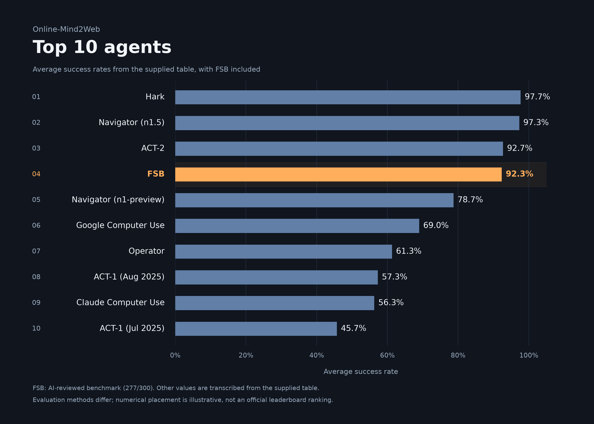

# FSB benchmark — AI-reviewed

**277/300 tasks — 92.33%**

Public FSB extension 0.9.92 · MCP 0.11.2 · Online-Mind2Web

| Difficulty | Successful / total | Success rate |
|---|---:|---:|
| Easy | 78/80 | 97.50% |
| Medium | 133/141 | 94.33% |
| Hard | 66/79 | 83.54% |

## Top 10 comparison

[PNG](results/benchmark-publication-20261022/charts/fsb-top-10.png) · [SVG](results/benchmark-publication-20261022/charts/fsb-top-10.svg) · [PDF](results/benchmark-publication-20261022/charts/fsb-top-10.pdf)

FSB is fourth numerically in the supplied comparison table. Evaluation methods differ; this is not an official leaderboard placement.

## Methods and task evidence

Reviewed by the **Codex AI assistant**. The task accounting, execution conditions, retry history and reviewer scope are documented in the [methodology](results/benchmark-publication-20261022/METHODOLOGY.md).

- [Machine-readable result](BENCHMARK-RESULT.json)
- [All 300 task verdicts](results/final-review-20261022/per-task-final.json) · [CSV](results/final-review-20261022/per-task-final.csv)
- [All 72 AI reassessments](results/final-review-20261022/task-reviews.json) · [CSV](results/final-review-20261022/task-reviews.csv)
- [Publication verification](results/benchmark-publication-20261022/VALIDATION.json) · [publication seal](results/benchmark-publication-20261022/FINAL-SEAL.json)

The score and task records are unchanged. This presentation is published separately from the existing sealed evaluations.
